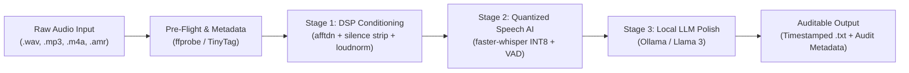

# Local AI Ambient Audio Transcription Pipeline

> **A high-performance, zero-cloud local AI transcription and audio enhancement pipeline engineered with Faster-Whisper, FFmpeg DSP filters, and Ollama local LLM refinement.**


<div align="center">

[](https://www.python.org/)
[](https://github.com/SYSTRAN/faster-whisper)
[](https://ollama.ai/)
[](https://ffmpeg.org/)
[](#-business-advantages--enterprise-roi)
[](LICENSE)

[**Explore Interactive Portfolio Showcase**](docs/portfolio_showcase.html) • [**Portfolio Asset & Video Storyboard Guide**](docs/PORTFOLIO_ASSETS_GUIDE.md)

</div>

---

## 🎯 Executive Overview

Raw ambient audio—such as board meetings, client consultations, conference calls, and field recordings—is notoriously difficult for AI speech recognition models:
* **Acoustic Noise & Reverb:** Background HVAC hum, room echo, and low Signal-to-Noise Ratio (SNR) cause degradation.
* **Silence Hallucinations:** Long room pauses cause standard Whisper models to hallucinate repetitive loop tokens (e.g. `[cough] thank you for watching...`).
* **Cloud Security & Cost:** Commercial speech APIs (OpenAI Whisper API, AWS Transcribe) require uploading sensitive corporate conversations over the WAN and generate steep recurring per-minute invoices.

**Transcribe_Ambient** solves these challenges by combining **multi-stage digital signal processing (DSP)** with **INT8 quantized local Whisper inference** and **on-premise LLM cognitive polish**. The entire pipeline operates 100% offline with zero cloud egress and zero recurring API bills.

---

## 🚀 System Architecture & Data Flow



1. **Ingestion & Dynamic Routing:** Scans watched staging folders for audio (`.wav`, `.mp3`, `.m4a`, `.aac`, `.amr`, `.3ga`). Auto-classifies source categories (`[Voicemail]`, `[OBS_ScreenCap]`, `[EarSpy_Ambient]`) and applies regex timestamp normalization.
2. **Pre-Flight Inspection & Metadata:** `ffprobe` / `TinyTag` extracts codec, bit rate, sample rate, channels, and duration while verifying hardware constraints.
3. **Digital Signal Processing (DSP):** FFmpeg executes an adaptive filter chain:
   * `afftdn=nr=12:nf=-30`: Adaptive FFT spectral noise profiling to reduce background electrical and environmental hum.
   * `silenceremove`: Dual-threshold silence stripping at `-30dB`, pruning dead air and shrinking audio duration by up to 60%.
   * `loudnorm`: EBU R128 loudness normalization and resample to 16kHz mono.
4. **AI Transcription Engine:** `faster-whisper` (CTranslate2 backend) executes INT8 quantized parallel beam search across CPU worker threads, protected by Voice Activity Detection (VAD) filters.
5. **LLM Polish & Enrichment:** Local LLMs via `Ollama` (`llama3`) act as an intelligent audio archivist—removing stutters, structuring dialogue into paragraphs, and prepending an ISO audit metadata header.

---

## 💼 Business Advantages & Enterprise ROI

| Capability | Cloud Hyperscalers (AWS / Google / OpenAI) | Transcribe_Ambient (Local Pipeline) |
| :--- | :--- | :--- |
| **Data Sovereignty** | Uploads corporate audio to third-party cloud servers | **100% On-Premise / Air-Gapped (Zero Cloud Egress)** |
| **Regulatory Compliance** | Complex BAA / Data Processing Agreements needed | **Inherently HIPAA, GDPR, SEC, & Attorney-Client Compliant** |
| **Marginal API Cost** | \$0.006 – \$0.024 per minute (Thousands/year at scale) | **$0.00 Perpetual (Runs on existing workstations)** |
| **Inference Resilience** | Subject to API outages, rate limits, and internet lag | **Deterministic, offline-first, zero downtime risk** |
| **Hallucination Control**| Raw audio fed directly to models, causing loops | **DSP silence stripping eliminates root cause of hallucinations** |

---

## ⚙️ Local Prerequisites

* **Python 3.10+**
* **FFmpeg** (must be installed and accessible in your system PATH)
* **Ollama** running locally (`ollama serve`) with `llama3` pulled:
  ```bash
  ollama pull llama3
  ```

---

## 🛠️ Quick Start & Installation

1. **Clone the repository:**
   ```bash
   git clone https://github.com/GarrettPapit/transcribe_ambient.git
   cd transcribe_ambient
   ```

2. **Create and activate a virtual environment:**
   ```bash
   # On Windows (PowerShell)
   python -m venv .venv
   .\.venv\Scripts\Activate.ps1

   # On macOS / Linux
   python3 -m venv .venv
   source .venv/bin/activate
   ```

3. **Install dependencies:**
   ```bash
   pip install -r requirements.txt
   ```

4. **Verify environment readiness:**
   ```bash
   python tools/test_environment.py
   ```

---

## 🖥️ Usage Modes

### 1. Desktop Graphical Interface (GUI)
Launch the user-friendly Tkinter desktop application with live dark-mode console logs:
```bash
python src/gui_transcribe.py
```
* Browse and select any target audio folder.
* Click **"Start Batch Processing"**.
* View real-time progress, file skipping detection, and streaming pipeline logs.

### 2. High-Throughput Batch CLI
Execute the automated CLI pipeline across any directory:
```bash
# Process default directory (./Files)
python src/transcribe_ambient.py

# Process specific folder with High-Sensitivity mode
python src/transcribe_ambient.py "C:\Path\To\Audio" --high-sensitivity

# Enable optional fallback modules (Ultimate Vocal Remover / Resolve)
python src/transcribe_ambient.py "C:\Path\To\Audio" --enable-uvr
```

### 3. Quantitative Pipeline Benchmarking
Evaluate processing speed and transcription fidelity across 4 filter and thread configurations:
```bash
python tools/benchmark_pipeline.py "sample_audio.wav"
```

---

## 📁 Repository Structure

```text
├── docs/
│   ├── hero_portfolio_banner.jpg      # 16:9 3D architecture portfolio hero graphic
│   ├── portfolio_showcase.html        # Interactive HTML5 showcase & UI mockup studio
│   ├── PORTFOLIO_ASSETS_GUIDE.md      # Video script, STAR case study, & screenshot guide
│   └── (System architecture diagrams & Ollama integration assets)
├── src/
│   ├── gui_transcribe.py              # Tkinter dark-mode desktop GUI application
│   ├── transcribe_ambient.py          # Production batch pipeline & dynamic audio router
│   └── run_pipeline.py                # Lightweight entrypoint wrapper
├── tools/
│   ├── benchmark_pipeline.py          # A/B testing suite (FFmpeg DSP vs. Thread scaling)
│   └── test_environment.py           # Pre-flight hardware and dependency diagnostic
├── .env.example                       # Documented environment configuration template
├── .gitignore                         # Project-specific ignore rules (secrets, venv, audio)
├── LICENSE                            # MIT License (Garrett Papit, 2026)
├── README.md                          # Production documentation
└── requirements.txt                   # Production Python package manifest
```

---

## 📄 License

This project is licensed under the [MIT License](LICENSE) — Copyright &copy; 2026 Garrett Papit.
